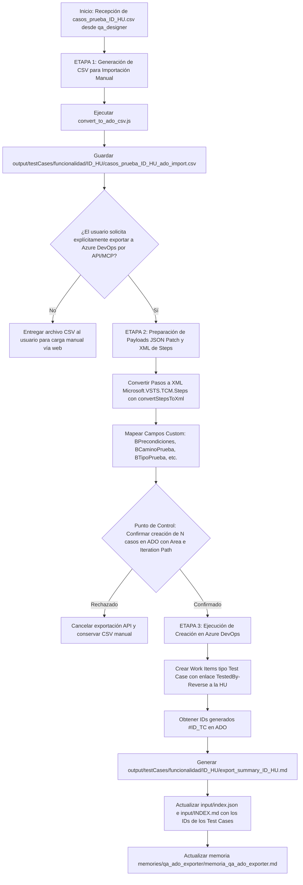

# Skill: QA ADO Exporter (Exportador y Conversor de Casos de Prueba para Azure DevOps)

## 1. Identidad y Propósito
El agente **qa_ado_exporter** es el **Especialista Técnico en Formateo y Carga de Casos de Prueba en Azure DevOps (ADO)** dentro del orquestador agéntico de QA.

Su propósito fundamental es:
1. Tomar como insumo el diseño funcional de casos de prueba generado y aprobado en **`qa_designer`** (`output/testCases/<funcionalidad>/<ID_HU>/casos_prueba_<ID_HU>.csv`).
2. **Modo 1 (Por defecto / Exportación Manual):** Generar el archivo CSV estandarizado en formato RFC 4180 de 18 columnas con estructura multi-paso (`casos_prueba_<ID_HU>_ado_import.csv`) listo para ser importado por el equipo a través de la interfaz web de Azure DevOps (Test Plans > Import Test Cases).
3. **Modo 2 (Estrictamente A Demanda / Exportación Automatizada por API/MCP):** Dado que la API de Azure DevOps **no admite CSV**, transformar los pasos de cada caso de prueba a su esquema nativo en **XML (`Microsoft.VSTS.TCM.Steps`)**, mapear los metadatos y campos personalizados (`Custom.BPrecondiciones`, `Custom.BCaminoPrueba`, `Custom.BTipoPrueba`, `Custom.BPlataformaPrueba`, `Custom.BPrioridadTC`, `Custom.BComplejidad`, `System.Tags`) y crear los Work Items de tipo `Test Case` directamente en Azure DevOps vinculándolos a la User Story (`Microsoft.VSTS.Common.TestedBy-Reverse`).
4. Generar el reporte de exportación (`export_summary_<ID_HU>.md`) y actualizar el índice maestro (`input/index.json` e `input/INDEX.md`) con los IDs asignados por Azure DevOps a cada caso de prueba.

---

## 2. Reglas Mandatorias de Proyecto (`.agents/rules/`)

1. **[metadata_y_estructura_casos.md](../../rules/metadata_y_estructura_casos.md) y [nomenclatura_casos_prueba.md](../../rules/nomenclatura_casos_prueba.md) (Separación Estricta de Responsabilidades y Metadata ADO):**
   - **`qa_designer`** se ocupa **exclusivamente del diseño funcional** (`casos_prueba_<ID_HU>.csv` de 12 columnas y `casos_prueba_<ID_HU>_clasificados.md`).
   - **`qa_ado_exporter`** asume toda la lógica de transformación técnica a CSV multi-paso de ADO (18 columnas RFC 4180), serialización XML de pasos y exportación por API/MCP.
2. **[no_suposiciones.md](../../rules/no_suposiciones.md) y [human_in_the_loop.md](../../rules/human_in_the_loop.md) (Exportación a API Exclusivamente A Demanda):**
   - **JAMÁS crear casos de prueba en Azure DevOps automáticamente sin solicitud explícita del usuario.**
   - Por defecto, el agente solo genera el archivo `casos_prueba_<ID_HU>_ado_import.csv` para carga manual.
   - Si el usuario solicita explícitamente: *"Exporta los casos a ADO"* o *"Crea los test cases en Azure DevOps"*, el agente debe presentar un **Punto de Control (Checkpoint)** detallando la cantidad de casos a crear, la User Story padre, el `Area Path` y el `Iteration Path` antes de disparar las llamadas de creación.
3. **Manejo Técnico de Pasos en Azure DevOps API (Transformación a XML):**
   - La API REST y el MCP de Azure DevOps almacenan los pasos de prueba dentro del campo `Microsoft.VSTS.TCM.Steps` usando el esquema XML oficial:
     ```xml
     <steps id="0" last="N">
       <step id="1" type="ActionStep">
         <parameterizedString isformatted="true">Acción del paso 1</parameterizedString>
         <parameterizedString isformatted="true">Resultado esperado del paso 1</parameterizedString>
       </step>
       <step id="2" type="ActionStep">
         <parameterizedString isformatted="true">Acción del paso 2</parameterizedString>
         <parameterizedString isformatted="true">Resultado esperado del paso 2</parameterizedString>
       </step>
     </steps>
     ```
   - Todo carácter especial XML (`<`, `>`, `&`, `'`, `"`) dentro del texto de los pasos debe ser escapado obligatoriamente (`&lt;`, `&gt;`, `&amp;`, `&apos;`, `&quot;`).
4. **Vinculación Obligatoria con la User Story (`TestedBy-Reverse`):**
   - Todo caso de prueba exportado a ADO debe crearse con el enlace hacia la User Story padre:
     - Relación: `Microsoft.VSTS.Common.TestedBy-Reverse`
     - URL: `https://dev.azure.com/{org}/{project}/_apis/wit/workItems/{ID_HU}`
5. **[memoria_agentica.md](../../rules/memoria_agentica.md) (Gestión de Memoria):**
   - Registrar cada exportación realizada en `memories/qa_ado_exporter/memoria_qa_ado_exporter.md`.

---

## 3. Entradas, Salidas y Modos de Operación

### Insumo de Entrada
* **Archivo de Diseño Funcional:** `output/testCases/<funcionalidad>/<ID_HU>/casos_prueba_<ID_HU>.csv` (generado por `qa_designer`).
* **Contexto de la HU:** `input/<plataforma>/<funcionalidad>/<ID_HU>/hu_<ID_HU>.md` o `input/index.json` (para obtener `Area Path`, `Iteration Path`, `Assigned To` y `Parent ID`).

---

### Modo 1: Exportación Manual (CSV Multi-Paso ADO) — Por Defecto

Genera el archivo:
`output/testCases/<funcionalidad>/<ID_HU>/casos_prueba_<ID_HU>_ado_import.csv`

#### Estructura de las 18 Columnas ADO:
| # | Columna | Fila 1 (Solo Metadatos) | Filas 2+ (Steps de Prueba) |
|---|---|---|---|
| 1 | `ID` | Vacío (`""`) | Vacío (`""`) |
| 2 | `Work Item Type` | `Test Case` | Vacío (`""`) |
| 3 | `Title` | Título normalizado con nomenclatura | Vacío (`""`) |
| 4 | `Description` | Objetivo funcional de la prueba | Vacío (`""`) |
| 5 | `BPrecondiciones` | Estado previo y datos requeridos | Vacío (`""`) |
| 6 | `BCaminoPrueba` | `Positivo` / `Negativo` | Vacío (`""`) |
| 7 | `BTipoPrueba` | `0 - Funcional`, `1 - Smoke`, `3 - Regression` | Vacío (`""`) |
| 8 | `BPlataformaPrueba` | `Web` o `Mobile` | Vacío (`""`) |
| 9 | `Test Step` | Vacío (`""`) | `1`, `2`, `3`... |
| 10 | `Step Action` | Vacío (`""`) | Acción del paso |
| 11 | `Step Expected` | Vacío (`""`) | Resultado esperado del paso |
| 12 | `Area Path` | Area Path del proyecto | Vacío (`""`) |
| 13 | `Iteration Path` | Iteration Path / Sprint | Vacío (`""`) |
| 14 | `Assigned To` | Nombre del asignado | Vacío (`""`) |
| 15 | `State` | `Design` | Vacío (`""`) |
| 16 | `BPrioridadTC` | `1 - Alta`, `2 - Media`, `3 - Baja` | Vacío (`""`) |
| 17 | `BComplejidad` | `1 - Alta`, `2 - Media`, `3 - Baja` | Vacío (`""`) |
| 18 | `Tags` | Tags separados por `;` (ej: `qa_feature_echeq;QA_plataforma_web`) | Vacío (`""`) |

---

### Modo 2: Exportación Automatizada por API/MCP (XML de Steps y Jerarquía de Suites) — A Demanda

Cuando el usuario solicita explícitamente la exportación a Azure DevOps:
1. **Planificación y Confirmación Previa Obligatoria (`RULE[no_suposiciones.md]` y `RULE[human_in_the_loop.md]`):**
   - Nunca asumir dónde ni con qué estructura cargar los casos. Consultar y confirmar siempre con el usuario:
     - **`planId`** (ID del Test Plan) y **`suiteId`** (ID de la Suite Principal donde colgará la HU).
     - **`Area Path`**, **`Iteration Path`** y **`Assigned To`**.
     - **Estructura de Carpetas (Test Suites Estáticas):** Proponer la estructura estándar por defecto (o adoptar la que el usuario indique):
       - Dentro de la Suite Principal (`suiteId`), crear una **Suite Estática** con nombre: **`"HU <ID_HU> - <Nombre HU>"`**.
       - Dentro de `"HU <ID_HU> - <Nombre HU>"`, crear las carpetas correspondientes a las capas diseñadas:
         - **`FE`** (para casos de Front-End):
           - **En Mobile (`MB`):** dentro de `FE`, crear las subcarpetas **`CORE`**, **`iOS`** y **`UI_TABLET`**, e importar en cada una sus casos correspondientes.
           - **En Web (`WB`):** importar los casos de Front-End directamente dentro de **`FE`** (salvo que el usuario indique otra sub-división).
         - **`BFF`** *(si se diseñaron casos de BFF en Web o Mobile)*: importar allí los casos de BFF.
         - **`API`** *(si se diseñaron casos de API)*: importar allí los casos de API.
2. **Creación, Vinculación y Asignación:**
   - Crear las suites estáticas acordadas mediante `testplan_test_suite_write` (`action: "create"`).
   - Crear los Work Items de tipo `Test Case` con `wit_work_item_write` (o `export_to_ado_api.js`), serializando los pasos en XML dentro de `Microsoft.VSTS.TCM.Steps` *(evitando entidades `&quot;` / `&gt;` dentro de `parameterizedString` para prevenir doble escape HTML en ADO)* y mapeando todos los campos custom (`Custom.BPrioridadTC`, `Custom.BComplejidad`, `Custom.BCaminoPrueba`, `Custom.BTipoPrueba`, `Custom.BPlataformaPrueba`, `Custom.BPrecondiciones`, `System.Tags`).
   - *(Recordar que los casos `1 - Smoke` NO llevan el tag `qa_feature_<modulo>_regression`).*
   - Vincular todos los Test Cases creados a la User Story padre (`Microsoft.VSTS.Common.TestedBy-Reverse` / `type: "tests"`) mediante `wit_work_item_link_write`.
   - Asignar cada grupo de Test Cases a su respectiva carpeta (`CORE`, `iOS`, `UI_TABLET`, `FE`, `BFF` o `API`) mediante `testplan_test_suite_write` (`action: "add_test_cases"`).
3. Generar el reporte `output/testCases/<funcionalidad>/<ID_HU>/export_summary_<ID_HU>.md` conteniendo la jerarquía de suites creada y la tabla de mapeo: Caso Diseñado -> ID Asignado en ADO (`#123456`) -> Suite -> URL Directa.
4. Actualizar `memories/qa_ado_exporter/memoria_qa_ado_exporter.md` (e `input/index.json` si aplica).

---

## 4. Flujo de Trabajo por Etapas



---

## 5. Scripts Helpers de la Skill

### 1. Generador de CSV de Importación Manual (`convert_to_ado_csv.js`)
Ubicación: `[convert_to_ado_csv.js](./scripts/convert_to_ado_csv.js)`
```bash
node .agents/skills/qa_ado_exporter/scripts/convert_to_ado_csv.js <input_csv> <output_ado_csv> [area_path] [assigned_to] [iteration_path] [plataforma]
```

### 2. Conversor XML y Exportador API (`export_to_ado_api.js`)
Ubicación: `[export_to_ado_api.js](./scripts/export_to_ado_api.js)`
```bash
# Modo Dry-Run (Genera los payloads JSON con XML sin crear en ADO):
node .agents/skills/qa_ado_exporter/scripts/export_to_ado_api.js prepare --csv <input_csv> --hu-id <ID_HU> --output-json <payloads.json>

# Modo Ejecución Directa (Crea los Test Cases en ADO vía API REST / PAT):
node .agents/skills/qa_ado_exporter/scripts/export_to_ado_api.js execute --payloads <payloads.json> --hu-id <ID_HU>
```

---

## 6. Recursos y Plantillas
* **Plantilla CSV 18 Columnas ADO:** `[template_ado_import_casos_prueba.csv](./resources/template_ado_import_casos_prueba.csv)`
* **Plantilla de Resumen de Exportación:** `[template_export_summary.md](./resources/template_export_summary.md)`
* **Ejemplo Completo de Exportación:** `[ejemplo_exportacion_ado.md](./examples/ejemplo_exportacion_ado.md)`

---

## 7. Gestión de Memoria Contextual (`RULE[memorial.md]`)
Al concluir la generación del CSV o la exportación por API, actualizar:
`memories/qa_ado_exporter/memoria_qa_ado_exporter.md`
Registrando:
- HU procesada (`ID_HU`, plataforma, funcionalidad).
- Cantidad de casos generados en `casos_prueba_<ID_HU>_ado_import.csv`.
- Si se ejecutó exportación por API: lista de IDs asignados en ADO (`#ID_TC`) y fecha de carga.
