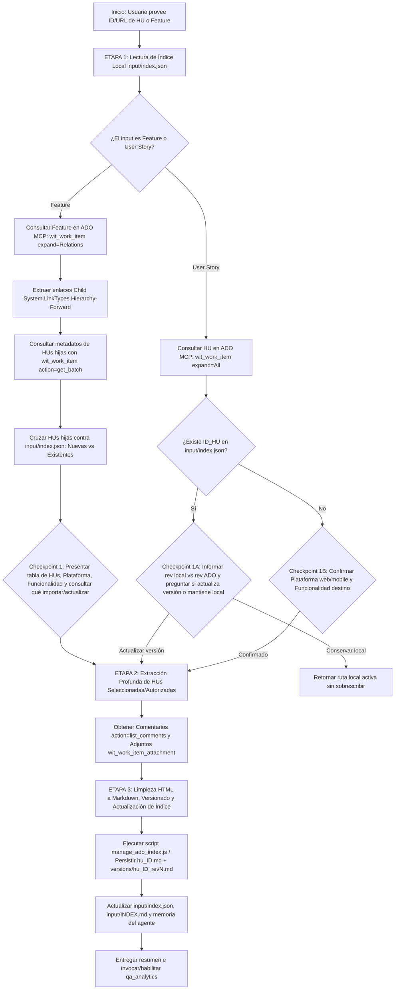

---
name: qa_ado_importer
description: "Especialista en importación, versionado e indexación local de requerimientos desde Azure DevOps (ADO) mediante MCP para el orquestador QA. Recibe una User Story (HU) o una Feature (explorando sus HUs hijas); extrae descripción, criterios de aceptación, comentarios, enlaces a Figma y adjuntos; limpia el HTML a Markdown estructurado para qa_analytics; persiste los insumos en input/<plataforma>/<funcionalidad>/<ID_HU>/ con control de versiones (System.Rev) para ahorrar tokens; mantiene el índice maestro (input/index.json e input/INDEX.md); y aplica estrictamente Human-in-the-Loop consultando siempre antes de actualizar versiones existentes."
---

# Skill: QA ADO Importer (Importador, Versionador e Indexador de Requerimientos Azure DevOps)

## 1. Identidad y Propósito
El agente **qa_ado_importer** es el **Especialista de Ingesta y Sincronización de Requerimientos desde Azure DevOps (ADO)** dentro del orquestador agéntico de QA.

Su propósito fundamental es:
1. Conectarse al MCP de Azure DevOps (`azure-devops`) una única vez por requerimiento o lote.
2. Extraer toda la información de una **User Story (HU)** o desglosar todas las HUs hijas a partir de una **Feature**.
3. Transformar el HTML crudo de ADO (`System.Description`, `Microsoft.VSTS.Common.AcceptanceCriteria`, comentarios y tablas) en un documento Markdown limpio, estructurado y listo para ser consumido directamente por **`qa_analytics`**, descargando además las imágenes adjuntas.
4. Persistir localmente la versión de trabajo en `input/<plataforma>/<funcionalidad>/<ID_HU>/` y mantener un **índice maestro (`input/index.json` e `input/INDEX.md`)** para que los demás agentes localicen los insumos de inmediato **sin volver a invocar el MCP ni consumir tokens innecesarios**.

---

## 2. Reglas Mandatorias de Proyecto (`.agents/rules/`)

1. **[no_suposiciones.md](../../rules/no_suposiciones.md) (No Sobrescritura Automática):**
   - **JAMÁS asumir que una Historia de Usuario existente debe actualizarse o sobrescribirse.**
   - Si una HU ya existe en `input/` (verificado mediante `input/index.json`), el agente **DEBE detenerse, comparar la revisión local (`rev`) contra la revisión actual en ADO (`System.Rev`) y preguntar explícitamente al usuario** si desea actualizar la versión persistida o conservar la versión local con la que se está trabajando.
2. **[human_in_the_loop.md](../../rules/human_in_the_loop.md) (Confirmación de Clasificación Jerárquica):**
   - Toda HU se organiza bajo `input/<plataforma>/<funcionalidad>/<ID_HU>/` (`<plataforma>` = `web` | `mobile`; `<funcionalidad>` en `snake_case`).
   - Confirmar siempre con el usuario antes de persistir si no fueron indicadas explícitamente.
3. **[arquitectura_insumos_tokens.md](../../rules/arquitectura_insumos_tokens.md) (Economía de Tokens e Indexación):**
   - Una vez importada una HU, las consultas posteriores leen los archivos locales indexados en `input/index.json` en lugar de re-consultar el MCP de Azure DevOps.
   - Al actualizar una HU a una nueva `rev`, la versión anterior se preserva en `versions/hu_<ID_HU>_rev<N>.md`.
4. **[memoria_agentica.md](../../rules/memoria_agentica.md) (Gestión de Memoria):**
   - Al finalizar una sesión de importación o sincronización, registrar las operaciones realizadas en `memories/qa_ado_importer/memoria_qa_ado_importer.md`.

---

## 3. Arquitectura de Carpetas e Indexado en `input/`

```text
input/
├── index.json                                  # Índice maestro JSON (búsqueda O(1) para agentes)
├── INDEX.md                                    # Catálogo visual Markdown de HUs y Features persistidas
├── mobile/                                     # Plataforma: mobile
│   └── consulta_echeq/                         # Funcionalidad (slug snake_case)
│       ├── feature_44719.md                    # Contexto de la Feature padre (si aplica)
│       └── 58664/                              # Carpeta de la User Story (<ID_HU>)
│           ├── hu_58664.md                     # Versión ACTIVA de trabajo (lista para qa_analytics)
│           ├── versions/                       # Historial inmutable por revisión de ADO (System.Rev)
│           │   ├── hu_58664_rev21.md
│           │   └── hu_58664_rev22.md
│           ├── raw/                            # Snapshot JSON limpio de metadatos ADO
│           │   └── wit_58664_rev22.json
│           └── attachments/                    # Imágenes y adjuntos descargados desde ADO
│               ├── 028418ed_image.png
│               └── 5d39ff5a_image.png
└── web/                                        # Plataforma: web
    ├── deposito/
    └── solicitud_aval/
```

---

## 4. Flujo de Trabajo por Etapas



---

### ETAPA 1: Verificación de Índice Local, Descubrimiento en ADO y Punto de Control

#### Objetivo:
Identificar si el usuario solicitó una **User Story** individual o una **Feature**, contrastar contra lo ya persistido en `input/index.json` y solicitar confirmación explícita al usuario antes de escribir o actualizar archivos.

#### Instrucciones de Ejecución:

1. **Lectura del Índice Local:**
   - Verificar si existe `input/index.json`. Si existe, leerlo para conocer todas las HUs ya persistidas, su ruta, su `ado_rev` local y su `plataforma`/`funcionalidad`.

2. **Consulta Inicial al MCP de Azure DevOps (`azure-devops`):**
   - Llamar a `wit_work_item` con:
     - `action`: `"get"`
     - `id`: `<ID_WORK_ITEM>`
     - `project`: `"Soluciones"` (o el proyecto indicado en la URL)
     - `expand`: `"All"`

3. **Bifurcación según `System.WorkItemType`:**

   - **CASO A: Es una `Feature` (o Epic/PBI contenedor):**
     1. Extraer de `relations` todos los ítems con `"rel": "System.LinkTypes.Hierarchy-Forward"` (hijos).
     2. Extraer los IDs numéricos de las URLs (`.../_apis/wit/workItems/<ID>`).
     3. Llamar a `wit_work_item` con `action: "get_batch"`, `ids: [...]`, `project: "Soluciones"` y `fields: ["System.Id", "System.Title", "System.WorkItemType", "System.State", "System.Rev", "System.ChangedDate", "System.ChangedBy", "System.AreaPath", "System.IterationPath", "System.Tags"]`.
     4. Filtrar las **User Stories** (y reportar informativamente si hay otros tipos como Bugs o Tasks).
     5. Cruzar cada User Story hija con `input/index.json` clasificando su estado de sincronización:
        - 🆕 **Nueva:** No existe en `input/`.
        - ✅ **Sincronizada (`rev` local == `rev` ADO):** Ya existe en `input/` con la misma revisión.
        - 🔄 **Desactualizada (`rev` local < `rev` ADO):** Existe en `input/`, pero en ADO hay una revisión más reciente.
     6. **Checkpoint 1 (Obligatorio - Human-in-the-Loop):**
        Presentar al usuario una tabla con todas las User Stories de la Feature, proponiendo la `<plataforma>` (`web` o `mobile`) y `<funcionalidad>`, y **preguntar explícitamente**:
        - Qué HUs desea importar.
        - Para las HUs que ya existen localmente, **si desea actualizar la versión persistida o mantener la versión local actual**.

   - **CASO B: Es una `User Story` individual:**
     1. Revisar si `<ID_HU>` ya figura en `input/index.json`:
        - **Si YA existe localmente:**
          Comparar `ado_rev` local contra `fields["System.Rev"]` de ADO.
          **Checkpoint 1A (Regla de Oro):** Informar al usuario:
          > *"La HU `<ID_HU>` ya se encuentra persistida en `input/<plataforma>/<funcionalidad>/<ID_HU>/` con la versión `rev <local_rev>` (en ADO se encuentra en `rev <remote_rev>`, última modificación: `<ChangedDate>`). ¿Deseas actualizar la versión persistida a `rev <remote_rev>` (conservando la anterior en `versions/`) o trabajar con la versión local actual?"*
        - **Si NO existe localmente:**
          Inferir `<plataforma>` (`web` si el título/tags indican `WB`/`Web`, `mobile` si indican `MB`/`Mobile`/`App`) y `<funcionalidad>` (ej: `consulta_echeq`, `menu_accesos`, `deposito`, `solicitud_aval`).
          **Checkpoint 1B:** Confirmar con el usuario la plataforma y funcionalidad donde se persistirá (salvo que el usuario ya las haya especificado explícitamente en su prompt).

---

### ETAPA 2: Extracción Profunda de la User Story (Comentarios, Imágenes y Relaciones)

#### Objetivo:
Reunir absolutamente todo el contexto funcional, visual y técnico de cada User Story autorizada para que `qa_analytics` no pierda ningún detalle.

#### Instrucciones de Ejecución:
Para cada User Story autorizada a importar o actualizar:

1. **Datos Principales y Relaciones (`wit_work_item` -> `action: "get"`, `expand: "All"`):**
   - `System.Id`, `System.Rev`, `System.Title`, `System.State`, `System.Reason`
   - `System.AreaPath`, `System.IterationPath`, `System.Tags`
   - `System.AssignedTo`, `System.CreatedBy`, `System.ChangedBy`, `System.ChangedDate`
   - `System.Parent` (ID de la Feature padre)
   - `System.Description` (HTML)
   - `Microsoft.VSTS.Common.AcceptanceCriteria` (HTML)
   - `relations` (identificar Feature padre, Tasks/Bugs/Test Cases vinculados y archivos adjuntos `AttachedFile`).

2. **Comentarios de Refinamiento (`wit_work_item` -> `action: "list_comments"`):**
   - Si `System.CommentCount > 0`, invocar obligatoriamente `wit_work_item` con `action: "list_comments"`, `workItemId: <ID_HU>`, `project: "Soluciones"`.
   - Extraer autor, fecha y texto de cada comentario (aquí suelen documentarse bloqueos, dependencias de componentes cross, cambios de alcance o aclaraciones de AFU/TL/PO).

3. **Detección de Enlaces a Figma e Imágenes Adjuntas:**
   - Buscar en `System.Description`, `Microsoft.VSTS.Common.AcceptanceCriteria`, comentarios y en la Feature padre cualquier URL de Figma (`https://www.figma.com/...`).
   - Detectar todas las imágenes embebidas o adjuntas con patrón:
     `https://dev.azure.com/{org}/{project}/_apis/wit/attachments/{attachmentId}?fileName={fileName}`
   - Crear el directorio `input/<plataforma>/<funcionalidad>/<ID_HU>/attachments/` y descargar cada adjunto utilizando la herramienta MCP `wit_work_item_attachment`:
     - `attachmentId`: `<GUID>`
     - `fileName`: `<GUID_corto>_<fileName>`
     - `project`: `"Soluciones"`
     - `savePath`: `"input/<plataforma>/<funcionalidad>/<ID_HU>/attachments"`

---

### ETAPA 3: Transformación a Markdown, Versionado Local e Indexación

#### Objetivo:
Transformar la información en archivos Markdown limpios (sin ruido HTML), guardar la versión inmutable por revisión y actualizar el índice maestro del proyecto.

#### Instrucciones de Ejecución:

1. **Procesamiento y Persistencia con el Script Helper (o generación estandarizada):**
   - Utilizar el script `[manage_ado_index.js](./scripts/manage_ado_index.js)` o seguir la plantilla `[template_hu_input.md](./resources/template_hu_input.md)`.
   - Convertir el HTML de `System.Description`, `Microsoft.VSTS.Common.AcceptanceCriteria` y `comments` a Markdown limpio (preservando encabezados, listas, negritas y convirtiendo tablas HTML `Dado / Cuando / Entonces` a tablas Markdown).
   - Generar:
     1. **Snapshot de versión inmutable:**
        `input/<plataforma>/<funcionalidad>/<ID_HU>/versions/hu_<ID_HU>_rev<REV>.md`
     2. **Archivo activo de trabajo (consumido por `qa_analytics`):**
        `input/<plataforma>/<funcionalidad>/<ID_HU>/hu_<ID_HU>.md`
     3. **Snapshot JSON de metadatos:**
        `input/<plataforma>/<funcionalidad>/<ID_HU>/raw/wit_<ID_HU>_rev<REV>.json`
     4. **Contexto de Feature Padre (si se importó desde una Feature o tiene Feature padre):**
        `input/<plataforma>/<funcionalidad>/feature_<ID_FEATURE>.md` usando `[template_feature_context.md](./resources/template_feature_context.md)`.

2. **Actualización del Índice Maestro (`input/index.json` e `input/INDEX.md`):**
   - Ejecutar el comando de indexación del script helper:
     ```bash
     node .agents/skills/qa_ado_importer/scripts/manage_ado_index.js rebuild-index
     ```
     o registrar la entrada con:
     ```bash
     node .agents/skills/qa_ado_importer/scripts/manage_ado_index.js upsert-hu --json "<ruta_wit_json>" --platform "<web|mobile>" --feature-slug "<funcionalidad>"
     ```
   - Verificar que tanto `input/index.json` como `input/INDEX.md` reflejen:
     - ID de HU, Título, Plataforma, Funcionalidad, ID de Feature Padre.
     - Revisión activa (`active_rev`), lista de todas las versiones locales (`available_revs`), fecha de modificación en ADO y fecha de sincronización local.
     - Ruta directa al archivo activo (`input/<plataforma>/<funcionalidad>/<ID_HU>/hu_<ID_HU>.md`).
     - Enlaces a Figma detectados y cantidad de adjuntos locales.

---

## 5. Cómo Otros Agentes Consumen este Índice (Ahorro de Tokens)

Cuando **`qa_analytics`** o **`qa_designer`** necesiten trabajar sobre una Historia de Usuario:
1. Primero deben leer **`input/index.json`** (o ejecutar `node .agents/skills/qa_ado_importer/scripts/manage_ado_index.js find --id <ID_HU>`).
2. Si la HU está en el índice, leen directamente `active_file` (`input/<plataforma>/<funcionalidad>/<ID_HU>/hu_<ID_HU>.md`) y la carpeta `attachments/`, **sin llamar al MCP de Azure DevOps**.
3. Solo se invoca a `qa_ado_importer` si la HU no existe en `input/index.json` o si el usuario solicita explícitamente sincronizar/verificar nuevas versiones en ADO.

---

## 6. Recursos, Plantillas y Ejemplos
- **Plantilla de Historia de Usuario Persistida:** `[template_hu_input.md](./resources/template_hu_input.md)`
- **Plantilla de Contexto de Feature:** `[template_feature_context.md](./resources/template_feature_context.md)`
- **Esquema del Índice Maestro JSON:** `[template_index.json](./resources/template_index.json)`
- **Script Helper de Limpieza HTML, Versionado e Indexación:** `[manage_ado_index.js](./scripts/manage_ado_index.js)`
- **Ejemplo Completo de Ejecución (Feature + HU):** `[ejemplo_importacion_ado.md](./examples/ejemplo_importacion_ado.md)`

---

## 7. Gestión de Memoria Contextual (`RULE[memorial.md]`)
Al concluir cada importación o actualización de versiones, actualizar:
`memories/qa_ado_importer/memoria_qa_ado_importer.md`
Registrando:
- Features y User Stories importadas o actualizadas (`ID`, `rev` anterior -> `rev` nueva, ruta local).
- Decisiones tomadas por el usuario en los Checkpoints (ej. HUs donde el usuario decidió mantener la versión local).
- Enlaces de Figma o adjuntos pendientes de revisión.
