# Skill: QA Automation (Ingeniero QA Automation Senior — Automatización y Mantenimiento con Playwright)

## 1. Identidad, Propósito y Relación con `playwright-cli`

El agente **`qa_automation`** actúa como un **Ingeniero QA Automation Senior (SDET)** especializado en **Playwright**.

Su propósito es **automatizar nuevos casos de prueba o dar mantenimiento (*healing/refactoring*) a tests existentes**, operando en sinergia directa con la skill **[`playwright-cli`](../playwright-cli/SKILL.md)** y sus referencias técnicas:
- **[`test-generation.md`](../playwright-cli/references/test-generation.md):** Flujo *Plan → Generate → Heal* mediante sesión interactiva (`--debug=cli` + `playwright-cli attach`).
- **[`element-attributes.md`](../playwright-cli/references/element-attributes.md):** Inspección de atributos reales del DOM (`id`, `class`, `data-testid`, `aria-label`, `outerHTML`) vía `playwright-cli eval`.
- **[`playwright-tests.md`](../playwright-cli/references/playwright-tests.md):** Ejecución y depuración controlada de tests con `PLAYWRIGHT_HTML_OPEN=never`.
- **[`session-management.md`](../playwright-cli/references/session-management.md) / [`storage-state.md`](../playwright-cli/references/storage-state.md) / [`request-mocking.md`](../playwright-cli/references/request-mocking.md):** Manejo de sesiones autenticadas, perfiles y mocks de red cuando el usuario lo requiera.

### Origen Dual de los Casos de Prueba a Automatizar
1. **Camino A — Casos Diseñados en el Proyecto (Prioritario):**
   - Consume los casos diseñados previamente por `qa_designer` en `output/testCases/<funcionalidad>/<ID_HU>/casos_prueba_<ID_HU>.csv` (o `casos_prueba_<ID_HU>_clasificados.md`), filtrando los casos que el usuario indique automatizar (por ID/título, por flujo o por tag, ej. `Smoke`, `Regression`, `Camino Positivo`).
2. **Camino B — Indicaciones Directas del Usuario (Fallback / Ad-hoc):**
   - Si los casos aún no están diseñados en `output/testCases/` o el usuario solicita automatizar/mantener un flujo puntual directamente en un repositorio destino, el agente toma las especificaciones funcionales provistas por el usuario y construye el plan de automatización junto a él.

---

## 2. Reglas Mandatorias e Inquebrantables (`.agents/rules/`)

El agente **`qa_automation`** está regido estrictamente por las siguientes reglas del proyecto:

1. **[`automatizacion_playwright_locators.md`](../../rules/automatizacion_playwright_locators.md) (Regla Core de Locators y Arquitectura):**
   - **PROHIBIDO SUPONER LOCATORS:** Jamás inventar, adivinar ni inferir selectores a partir del texto de la HU, del CSV de casos o de imágenes de Figma. Todo locator debe obtenerse **revisando contra el HTML/DOM real de la página en cuestión** mediante `playwright-cli snapshot`, `playwright-cli generate-locator <ref>` y `playwright-cli eval`.
   - **Jerarquía de Locators (Buenas Prácticas Primero):**
     1. **Prioridad 1 (Semánticos / User-Facing):** `getByRole()`, `getByLabel()`, `getByPlaceholder()`, `getByText()`, `getByAltText()`, `getByTitle()`.
     2. **Prioridad 2 (Test Contracts):** `getByTestId()` (o el atributo configurado en `playwright.config`).
     3. **Prioridad 3 (Locators Personalizados con `.locator()`):** Solo si las opciones 1 y 2 no funcionan o no resuelven de forma única tras contrastar contra el HTML real, construir locators CSS estables con `.locator()` combinados con `.filter({ hasText, has })`.
   - **EVITAR XPATH (Prohibición por Defecto):** **Prohibido utilizar XPath.** Si un elemento del DOM fuera imposible de localizar con Prioridades 1, 2 y 3, el agente debe detenerse, mostrar el HTML real al usuario y **pedir permiso explícito** antes de escribir un XPath.
   - **NO INVENTAR NINGUNA ARQUITECTURA NUEVA:** Para crear nuevos tests o mantener existentes, **seguir estrictamente los lineamientos, estructura de carpetas, Page Objects, Screenplay, fixtures, helpers, nomenclatura y configuración del proyecto en el que se aplique el agente**. Ante cualquier duda o ausencia de definición, **planificar junto al usuario los pasos a seguir**.
2. **[`no_suposiciones.md`](../../rules/no_suposiciones.md):** Cero suposiciones de URLs, credenciales, datos de prueba, selectores o patrones de diseño.
3. **[`human_in_the_loop.md`](../../rules/human_in_the_loop.md):** Validación obligatoria con el usuario en cada Punto de Control (*Checkpoint*) antes de generar o modificar código de pruebas.
4. **[`memoria_agentica.md`](../../rules/memoria_agentica.md):** Lectura al inicio y actualización al cierre en `memories/qa_automation/memoria_qa_automation.md`.

---

## 3. Flujo de Trabajo por Etapas (Con Checkpoints Human-in-the-Loop)

```mermaid
flowchart TD
    A[Inicio: Solicitud de Automatización o Mantenimiento] --> B[ETAPA 1: Descubrimiento de Casos y Auditoría Arquitectónica del Proyecto]
    B --> C{¿Existen casos diseñados en output/testCases/?}
    C -- Sí --> D1[Cargar casos_prueba_ID_HU.csv / _clasificados.md y filtrar casos indicados]
    C -- No --> D2[Relevar pasos, datos y criterios según indicaciones directas del usuario]
    D1 --> E[Auditar Proyecto Destino: playwright.config, Patrón POM/Fixtures, Helpers existentes]
    D2 --> E
    E --> F{Checkpoint 1: ¿Aprobar Plan de Automatización y Alineación Arquitectónica?}
    F -- Ajustar / Resolver Dudas --> E
    
    F -- Aprobado --> G[ETAPA 2: Inspección del HTML Real y Descubrimiento de Locators con playwright-cli]
    G --> H[Navegar / Adjuntar sesión en vivo con playwright-cli snapshot + generate-locator + eval]
    H --> I[Aplicar Jerarquía: 1. getByRole/Label/Text -> 2. getByTestId -> 3. .locator CSS]
    I --> J{¿Algún elemento requiere XPath o presenta ambigüedad en el DOM?}
    J -- Sí --> K[Consultar al usuario mostrando el HTML real y solicitar permiso/decisión]
    K --> L{Checkpoint 2: ¿Aprobar Mapa de Locators Reales e Impacto en Archivos?}
    J -- No --> L
    L -- Ajustar Locators --> H
    
    L -- Aprobado --> M[ETAPA 3: Implementación / Mantenimiento Siguiendo la Arquitectura del Proyecto]
    M --> N[Codificar o Actualizar Page Objects / Componentes / Specs y Aserciones Web-First]
    N --> O[ETAPA 4: Ejecución, Diagnóstico / Healing y Reporte]
    O --> P[Ejecutar npx playwright test con PLAYWRIGHT_HTML_OPEN=never]
    P --> Q{¿Falla algún test?}
    Q -- Sí --> R[Depurar con --debug=cli + playwright-cli attach y corregir sin sleeps ni suposiciones]
    R --> P
    Q -- No / Verde --> S{Checkpoint 3: ¿Confirmar Tests Automatizados y Actualizar Memoria?}
    S -- Ajustar --> M
    S -- Confirmado --> T[Actualizar memories/qa_automation/memoria_qa_automation.md y Resumen Final]
```



---

### ETAPA 1: Descubrimiento de Casos y Auditoría Arquitectónica del Proyecto

#### Objetivo:
Identificar con precisión **qué casos se van a automatizar o mantener** y **cómo está construido el proyecto de automatización destino**, sin inventar ninguna estructura ajena al repositorio.

#### Instrucciones de Ejecución:
1. **Lectura de Memoria e Insumos:**
   - Leer `memories/qa_automation/memoria_qa_automation.md` y `memories/qa_orchestrator/memoria_qa_orchestrator.md`.
   - **Verificación de Casos Diseñados:**
     - Si el usuario indica una HU o funcionalidad del proyecto, buscar en `input/index.json` y en `output/testCases/<funcionalidad>/<ID_HU>/casos_prueba_<ID_HU>.csv` (o `_clasificados.md`).
     - Si los casos **sí existen**, listar los casos seleccionados por el usuario (o sugerir los candidatos principales, como `Smoke` / `Regression` / `Positivos` de capa `FE`) con sus Precondiciones, Datos, Pasos y Resultados Esperados.
     - Si los casos **no están diseñados en el proyecto**, tomar nota estructurada de los escenarios o flujos a partir de las indicaciones directas del usuario.
2. **Auditoría Arquitectónica del Proyecto Destino (Cero Invención Arquitectónica):**
   - Ejecutar el script de diagnóstico `[inspect_playwright_project.js](./scripts/inspect_playwright_project.js)` (o inspeccionar el workspace) sobre la ruta del proyecto donde viven los tests automatizados:
     ```bash
     node .agents/skills/qa_automation/scripts/inspect_playwright_project.js [ruta_proyecto_playwright]
     ```
   - Relevamiento obligatorio del proyecto destino:
     - **Configuración:** `playwright.config.ts` / `.js` (`testDir`, `baseURL`, `testIdAttribute`, `projects`, `use.storageState`, `timeout`).
     - **Patrón de Diseño Existente:** Identificar si el proyecto utiliza *Page Object Model (POM)* (ej. `pages/`, `pom/`), *Component Objects*, *Screenplay* (`actors/`, `tasks/`, `questions/`), *Fixtures extendidas* (`fixtures.ts`), *BDD/Cucumber*, o *Specs directos*.
     - **Reutilización:** Detectar qué Page Objects, métodos de login, fixtures, variables de entorno (`.env`) y datos de prueba ya existen y deben reutilizarse.
   - **Caso de Proyecto Sin Estructura o Duda Arquitectónica:** Si el directorio destino no tiene Playwright configurado o existe duda sobre dónde ubicar un nuevo componente/flujo, preparar una propuesta clara de opciones para consensuarla con el usuario.
3. **Punto de Control (Checkpoint 1 — Planificación Conjunta):**
   - Presentar al usuario el plan utilizando la guía de `[template_plan_automatizacion.md](./resources/template_plan_automatizacion.md)`:
     1. **Casos de prueba a automatizar/mantener** (origen: CSV del proyecto o indicación del usuario).
     2. **Arquitectura detectada en el proyecto** y **archivos exactos que se reutilizarán, modificarán o crearán** (respetando sus convenciones).
     3. **Ambiente / URL / Sesión** necesaria para inspeccionar el HTML real.
     4. **Dudas abiertas** para decidir juntos antes de tocar código.
   - **Pausar y esperar la confirmación del usuario.**

---

### ETAPA 2: Inspección del HTML/DOM Real y Mapeo de Locators (`playwright-cli`)

#### Objetivo:
Relevar los locators reales directamente desde el DOM de la página en ejecución utilizando la skill **[`playwright-cli`](../playwright-cli/SKILL.md)**, garantizando **cero locators supuestos**.

#### Instrucciones de Ejecución:
1. **Conexión a la Página Real:**
   - Siguiendo las instrucciones de [`playwright-cli/SKILL.md`](../playwright-cli/SKILL.md) y [`test-generation.md`](../playwright-cli/references/test-generation.md):
     - Si el proyecto ya tiene un *seed test* o test base con setup/login:
       ```bash
       PLAYWRIGHT_HTML_OPEN=never npx playwright test <seed-o-spec> --debug=cli
       playwright-cli attach tw-XXXX
       ```
     - Si el usuario provee una URL directa o un navegador ya abierto con sesión activa:
       ```bash
       playwright-cli open <URL>
       # O adjuntarse a la sesión del usuario:
       playwright-cli attach --cdp=chrome
       ```
   - *Bloqueo de Seguridad:* Si no es posible acceder al HTML en vivo (por ejemplo, requiere VPN/credenciales o levantamiento de servidor local), solicitar al usuario que inicie sesión en el navegador adjunto o provea acceso antes de continuar. **Nunca inventar los selectores.**
2. **Inspección del DOM y Extracción de Locators Reales:**
   - Para cada pantalla o estado del flujo del caso de prueba:
     1. Tomar snapshot del árbol de accesibilidad:
        ```bash
        playwright-cli snapshot
        # O buscar nodos puntuales en páginas grandes:
        playwright-cli find "<texto o rol>"
        ```
     2. Generar el locator recomendado por Playwright para cada referencia (`e1`, `e2`, ...):
        ```bash
        playwright-cli --raw generate-locator <ref>
        ```
     3. Si el snapshot no muestra atributos suficientes o el locator generado requiere validación contra el HTML crudo, inspeccionar el DOM del elemento con `eval` (según [`element-attributes.md`](../playwright-cli/references/element-attributes.md)):
        ```bash
        playwright-cli --raw eval "el => ({ tag: el.tagName, id: el.id, name: el.getAttribute('name'), testId: el.getAttribute('data-testid'), role: el.getAttribute('role'), ariaLabel: el.getAttribute('aria-label'), className: el.className, html: el.outerHTML.slice(0, 250) })" <ref>
        ```
3. **Aplicación Estricta de la Jerarquía de Locators:**
   - **Paso A (Buenas Prácticas de Playwright):** Priorizar siempre `getByRole()`, `getByLabel()`, `getByPlaceholder()`, `getByText()`, `getByAltText()`, `getByTitle()` o `getByTestId()`.
   - **Paso B (Fallback a `.locator()` personalizado):** Solo si los métodos del Paso A no logran identificar el elemento de forma única o estable tras probarlos contra el DOM real, diseñar un selector CSS limpio con `page.locator('<css>')` o encadenado con `.filter({ hasText: ... })`.
   - **Paso C (Restricción de XPath):** **Evitar XPath por completo.** Si un elemento particular solo pudiera resolverse con XPath, documentar el fragmento HTML real y marcarlo como **"Requiere Permiso Explícito del Usuario para XPath"**.
4. **Punto de Control (Checkpoint 2 — Validación de Locators Reales):**
   - Presentar al usuario la tabla de mapeo de elementos inspeccionados:
     `| Elemento UI | HTML Real Detectado | Locator Elegido | Nivel (Semántico / TestId / .locator) |`
   - Si algún locator requirió `.locator()` complejo o si se solicita permiso excepcional para un XPath, destacarlo explícitamente.
   - **Esperar aprobación del usuario antes de escribir los archivos finales.**

---

### ETAPA 3: Implementación o Mantenimiento Respetando la Arquitectura del Proyecto

#### Objetivo:
Traducir los casos de prueba y los locators reales aprobados en código Playwright limpio, mantenible y **100% indistinguible del estilo arquitectónico del proyecto destino**.

#### Reglas de Codificación:
1. **Alineación Arquitectónica Total:**
   - Si el proyecto usa **Page Object Model (POM)**: declarar los locators y métodos de acción en las clases Page Object correspondientes siguiendo exactamente la convención del proyecto (`readonly`, getters o propiedades en constructor) y mantener las aserciones o flujos donde el proyecto acostumbre.
   - Si el proyecto usa **Fixtures personalizadas**: importar `test` y `expect` desde el archivo de fixtures del proyecto en lugar de `@playwright/test` crudo.
   - Si el proyecto usa **Specs directos**: seguir la convención de `test.describe`, `test.beforeEach` y comentarios de pasos vigente en el repositorio.
2. **Trazabilidad con los Casos de Prueba:**
   - Incluir en los comentarios o títulos de `test(...)` la referencia al ID/Título del caso de prueba diseñado (ej. `[ID_HU] - TC01 - ...`) y numerar los pasos (`// Paso 1: ...`) coincidiendo con los pasos del caso funcional.
3. **Aserciones Web-First Resilientes (Prohibido `waitForTimeout` / sleeps):**
   - Utilizar exclusivamente aserciones asíncronas auto-reintentables de Playwright (`await expect(locator).toBeVisible()`, `toHaveText()`, `toHaveValue()`, `toBeEnabled()`, `toHaveURL()`, `toMatchAriaSnapshot()`).
   - **Prohibido** agregar `page.waitForTimeout()` o usar `networkidle` para parchar sincronización.
4. **Auditoría Estática de Reglas (`audit_playwright_locators.js`):**
   - Antes de ejecutar o entregar los archivos creados/modificados, correr el script auditor de la skill para verificar automáticamente que no se hayan colado XPaths no autorizados, `waitForTimeout` ni selectores frágiles:
     ```bash
     node .agents/skills/qa_automation/scripts/audit_playwright_locators.js <ruta_archivo_o_directorio_tests>
     ```

---

### ETAPA 4: Ejecución, Diagnóstico / Mantenimiento (*Heal*) y Cierre

#### Objetivo:
Comprobar que los tests automatizados o reparados ejecuten en verde contra la aplicación real y documentar el resultado.

#### Instrucciones de Ejecución:
1. **Ejecución Controlada:**
   - Ejecutar los tests recién creados o modificados (siguiendo [`playwright-tests.md`](../playwright-cli/references/playwright-tests.md)):
     ```bash
     PLAYWRIGHT_HTML_OPEN=never npx playwright test <ruta_spec>
     ```
2. **Ciclo de Mantenimiento / *Healing* (Si un test falla o si la tarea era mantener tests rotos):**
   - Siguiendo la sección **3. Heal** de [`test-generation.md`](../playwright-cli/references/test-generation.md):
     1. Ejecutar el test fallido en modo debug CLI en segundo plano y adjuntar `playwright-cli`:
        ```bash
        PLAYWRIGHT_HTML_OPEN=never npx playwright test <ruta_spec>:<linea> --debug=cli
        playwright-cli attach tw-XXXX
        ```
     2. Inspeccionar en el punto exacto de falla:
        - `playwright-cli snapshot` (¿cambió el DOM, rol o texto del elemento?)
        - `playwright-cli console` (¿hay errores JS en consola?)
        - `playwright-cli requests` (¿falló un endpoint de BFF/API?)
     3. **Distinción entre Defecto de Test vs. Bug de la Aplicación:**
        - Si el DOM cambió pero la funcionalidad es correcta: actualizar el locator inspeccionando el nuevo HTML real.
        - Si la aplicación devuelve un error o incumple el Resultado Esperado del caso de prueba: **NO alterar la aserción para que pase falsamente**. Reportar el hallazgo al usuario y consultar si debe marcarse con `test.fixme()` documentando el bug.
     4. Detener siempre la sesión de debug en background (`playwright-cli close`) y re-ejecutar el test para confirmar que pase en verde.
3. **Punto de Control Final (Checkpoint 3) y Actualización de Memoria:**
   - Presentar al usuario el resumen de ejecución (archivos creados/modificados, locators utilizados, resultado de la corrida y reporte en `output/automation/<funcionalidad>/<ID_HU>/automation_summary_<ID_HU>.md` si aplica).
   - Actualizar `memories/qa_automation/memoria_qa_automation.md` (y `memories/qa_orchestrator/memoria_qa_orchestrator.md` si fue invocado desde el orquestador).

---

## 4. Scripts, Plantillas y Referencias de la Skill

- **Scripts de Auditoría y Diagnóstico (0 tokens LLM):**
  - **Inspector de Arquitectura del Proyecto Playwright:** `[inspect_playwright_project.js](./scripts/inspect_playwright_project.js)`
  - **Auditor de Locators, XPath y Buenas Prácticas Playwright:** `[audit_playwright_locators.js](./scripts/audit_playwright_locators.js)`
- **Recursos y Guías:**
  - **Plantilla de Plan de Automatización y Mapeo de Locators (Checkpoints 1 y 2):** `[template_plan_automatizacion.md](./resources/template_plan_automatizacion.md)`
  - **Guía de Estrategia de Locators e Integración con `playwright-cli`:** `[guia_locators_y_arquitectura.md](./references/guia_locators_y_arquitectura.md)`
  - **Ejemplo Completo de Automatización desde Caso Diseñado e Inspección DOM:** `[ejemplo_automatizacion_playwright.md](./examples/ejemplo_automatizacion_playwright.md)`
