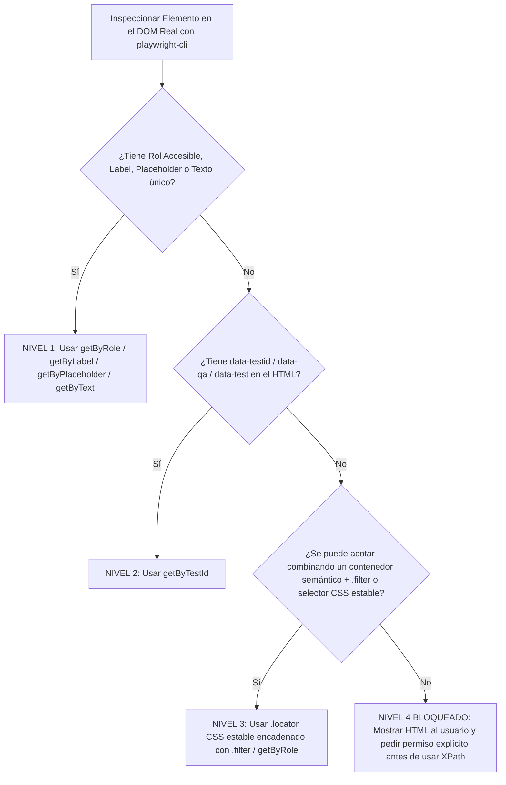

# Guía Técnica: Estrategia de Locators Reales e Integración con `playwright-cli` y Arquitectura del Proyecto

## 1. Integración Operativa entre `qa_automation` y `playwright-cli`

La skill **`qa_automation`** aporta la gobernanza de ingeniería de calidad (trazabilidad desde los casos diseñados en `output/testCases/` o requerimientos del usuario, respeto arquitectónico, jerarquía de locators y puntos de control *Human-in-the-Loop*), mientras que **[`playwright-cli`](../../playwright-cli/SKILL.md)** provee el motor de interacción e inspección en vivo del navegador.

### Comandos Clave de `playwright-cli` para No Suponer Locators

1. **Inspeccionar el Árbol de Accesibilidad (Primera Fuente):**
   ```bash
   playwright-cli snapshot
   # Para buscar un texto o patrón específico en páginas extensas:
   playwright-cli find "Emitir ECHEQ"
   playwright-cli find --regex "/Confirmar|Aceptar/i"
   ```
2. **Obtener el Locator Oficial Recomendado por Playwright:**
   Una vez identificado el `ref` en el snapshot (ej. `e14`), pedir a Playwright que calcule el locator semántico real:
   ```bash
   playwright-cli --raw generate-locator e14
   # Salida típica: getByRole('button', { name: 'Emitir ECHEQ' })
   ```
3. **Inspeccionar el HTML Crudo cuando el Snapshot no basta (`eval`):**
   Si el elemento no tiene un rol/nombre único en el snapshot y necesitamos revisar sus atributos reales en el DOM antes de usar `getByTestId` o `.locator()`:
   ```bash
   playwright-cli --raw eval "el => ({ tag: el.tagName, id: el.id, name: el.getAttribute('name'), testId: el.getAttribute('data-testid'), dataQa: el.getAttribute('data-qa'), classes: el.className, html: el.outerHTML.slice(0, 300) })" e14
   ```
4. **Probar un Locator Personalizado antes de Escribirlo en el Test:**
   Antes de guardar un `.locator(...)` en un Page Object o Spec, verificar en vivo que apunte exactamente al elemento deseado:
   ```bash
   playwright-cli highlight "locator('tr.echeq-row').filter({ hasText: '$ 150.000,00' })"
   ```

---

## 2. Árbol de Decisión de Locators (Regla de Prioridad)



### Ejemplos de Transformación Correcta (Basados en DOM Real)

| Caso en el DOM Real | ❌ Incorrecto (Supuesto / Frágil / XPath) | ✅ Correcto (`qa_automation`) |
| :--- | :--- | :--- |
| `<button class="btn-primary">Continuar</button>` | `page.locator('//button[text()="Continuar"]')` | `page.getByRole('button', { name: 'Continuar' })` |
| `<label for="cuit">CUIT Beneficiario</label><input id="cuit" />` | `page.locator('#cuit')` | `page.getByLabel('CUIT Beneficiario')` |
| `<div data-testid="saldo-cuenta">$ 1.250.000,00</div>` | `page.locator('div.css-19283 > span')` | `page.getByTestId('saldo-cuenta')` |
| Tabla con varias filas donde el botón "Anular" se repite por fila | `page.locator('(//button[contains(.,"Anular")])[3]')` | `page.getByRole('row', { name: /Cheque 00458/ }).getByRole('button', { name: 'Anular' })` _(o `page.locator('tr').filter({ hasText: '00458' }).getByRole('button', { name: 'Anular' })`)_ |

---

## 3. Guía de Adhesión a la Arquitectura del Proyecto Destino

Cuando `qa_automation` se aplica sobre un proyecto existente, **nunca impone una estructura propia**:

1. **Si el proyecto usa Page Object Model (POM) clásico (`pages/*.ts`):**
   - Mantener la misma estructura de clase, constructores, tipado (`Page`, `Locator`) y convención de nombres de métodos que ya tengan las páginas vecinas.
2. **Si el proyecto usa Fixtures de Playwright (`fixtures.ts`):**
   - Si el proyecto inyecta los Page Objects como fixtures (`test('...', async ({ loginPage, dashboardPage }) => ...)`), registrar cualquier nueva página en el archivo de fixtures existente siguiendo el mismo patrón.
3. **Si el proyecto aún no tiene arquitectura o hay más de un camino posible:**
   - Detenerse en el **Checkpoint 1**, exponer al usuario lo observado en el repositorio y acordar juntos cómo estructurar los archivos antes de generarlos.
