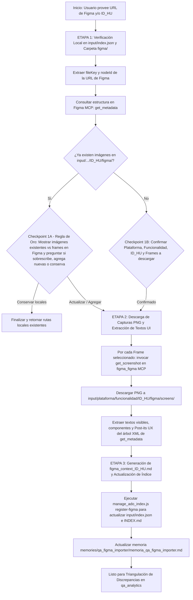

---
name: qa_figma_importer
description: "Especialista en importación, organización e indexación local de prototipos e imágenes de interfaz desde Figma mediante MCP (figma_figma) para el orquestador QA. Extrae estructura de frames, textos UI, notas UX y descarga capturas PNG de las pantallas; las persiste en input/<plataforma>/<funcionalidad>/<ID_HU>/figma/ sincronizadas con input/index.json e input/INDEX.md; aplica estrictamente la Regla de Oro (Human-in-the-Loop) consultando siempre antes de sobrescribir imágenes existentes; y prepara los insumos visuales para que qa_analytics detecte discrepancias entre el texto de la HU, las imágenes adjuntas en ADO y el diseño de Figma."
---

# Skill: QA Figma Importer (Importador, Catalogador e Indexador de Prototipos Figma)

## 1. Identidad y Propósito
El agente **qa_figma_importer** es el **Especialista en Ingesta de Diseños y Prototipos UI/UX desde Figma** dentro del orquestador agéntico de QA.

Su propósito fundamental es:
1. Conectarse al MCP de Figma (`figma_figma`) a partir de una URL de Figma (provista por el usuario o extraída automáticamente de una Historia de Usuario / Feature importada con `qa_ado_importer`).
2. Inspeccionar la estructura del nodo o sección (`get_metadata`), identificando las pantallas (*Frames*), componentes, textos visibles (*copy*), estados (*Empty States*, *Error States*, *Feature Flags*) y notas de diseño (*Post-its UX*).
3. Descargar las imágenes renderizadas (`.png`) de los prototipos (`get_screenshot`) y persistirlas localmente dentro de la misma estructura jerárquica de las Historias de Usuario:
   `input/<plataforma>/<funcionalidad>/<ID_HU>/figma/`
4. Generar un documento de contexto visual (`figma_context_<ID_HU>.md`) y actualizar el índice maestro (`input/index.json` e `input/INDEX.md`) para que **`qa_analytics`** pueda inspeccionar las imágenes locales y **detectar discrepancias entre lo escrito en la HU, las imágenes adjuntas en ADO y el prototipo de Figma**, sin volver a consumir tokens del MCP de Figma.

---

## 2. Reglas Mandatorias de Proyecto (`.agents/rules/`)

1. **[no_suposiciones.md](../../rules/no_suposiciones.md) (No Sobrescritura Automática):**
   - **JAMÁS sobrescribir imágenes o contextos de Figma existentes sin autorización explícita del usuario.**
   - Antes de descargar imágenes en `input/<plataforma>/<funcionalidad>/<ID_HU>/figma/`, verificar si ya existen imágenes o `figma_manifest.json`. Si existen, listar las imágenes locales actuales vs. los frames detectados en Figma y preguntar explícitamente si desea sobrescribir, descargar solo frames nuevos o conservar las actuales.
2. **[arquitectura_insumos_tokens.md](../../rules/arquitectura_insumos_tokens.md) (Alineación Jerárquica con las HUs):**
   - Las imágenes de Figma deben alojarse bajo `input/<plataforma>/<funcionalidad>/<ID_HU>/figma/`.
3. **[human_in_the_loop.md](../../rules/human_in_the_loop.md) (Selección Controlada de Frames):**
   - Cuando una URL de Figma apunta a una Sección o Página con múltiples frames, obtener primero la estructura con `get_metadata`, presentar al usuario el listado de pantallas encontradas y confirmar cuáles descargar antes de lanzar descargas masivas.
4. **[triangulacion_visual_figma_ado.md](../../rules/triangulacion_visual_figma_ado.md) (Insumo para Detección de Discrepancias):**
   - Al generar `figma_context_<ID_HU>.md`, extraer tanto la imagen como el inventario de textos literales (títulos, botones, labels, mensajes) y componentes presentes en el árbol de Figma para la triangulación 1 a 1 en `qa_analytics`.
5. **[memoria_agentica.md](../../rules/memoria_agentica.md) (Gestión de Memoria):**
   - Registrar cada importación o actualización de prototipos en `memories/qa_figma_importer/memoria_qa_figma_importer.md`.

---

## 3. Arquitectura de Carpetas en `input/` (Integrada con `qa_ado_importer`)

```text
input/
├── index.json                                          # Índice maestro JSON (incluye metadatos de Figma por HU)
├── INDEX.md                                            # Catálogo visual Markdown
└── mobile/                                             # Plataforma: mobile | web
    └── consulta_echeq/                                 # Funcionalidad (snake_case)
        ├── feature_44719.md
        └── 58664/                                      # ID de Historia de Usuario (<ID_HU>)
            ├── hu_58664.md                             # Texto y criterios de la HU (de ADO)
            ├── attachments/                            # Imágenes que estaban pegadas dentro de ADO
            │   └── 028418ed_image.png
            └── figma/                                  # Insumos importados desde Figma MCP
                ├── figma_context_58664.md              # Catálogo visual, textos UI y notas UX para qa_analytics
                ├── figma_manifest.json                 # Metadatos de versión, fileKey, nodeIds y hashes/fechas
                ├── history/                            # Respaldo de manifiestos/contextos previos si se actualiza
                └── screens/                            # Capturas PNG de alta nitidez de cada Frame/Pantalla
                    ├── 313-13505_Home-Bancor.png
                    ├── 1174-23361_Sidebar-Menu.png
                    └── 1-19840_ECHEQ-Accesos.png
```

---

## 4. Flujo de Trabajo por Etapas



---

### ETAPA 1: Verificación Local, Inspección de Estructura en Figma y Punto de Control

#### Objetivo:
Extraer `fileKey` y `nodeId` del enlace de Figma, conocer qué pantallas contiene en Figma, verificar si la HU ya posee imágenes descargadas localmente y solicitar confirmación al usuario.

#### Instrucciones de Ejecución:

1. **Extracción de Parámetros desde la URL de Figma:**
   - De una URL con formato `https://www.figma.com/design/<fileKey>/<fileName>?node-id=<int1>-<int2>`:
     - `fileKey`: `<fileKey>` (ej. `LGZBulfnpzDGHfWfVnIVIr`)
     - `nodeId`: `<int1>:<int2>` (ej. `1-19834` -> `1:19834`).
   - *Nota:* Si la URL es de una rama (`/branch/<branchKey>/`), usar `<branchKey>` como `fileKey`.

2. **Verificación del Índice Local y Carpeta `figma/`:**
   - Consultar `input/index.json` ejecutando:
     ```bash
     node .agents/skills/qa_ado_importer/scripts/manage_ado_index.js check --id <ID_HU>
     ```
   - Si la HU ya está indexada, tomar automáticamente su `<plataforma>` y `<funcionalidad>`.
   - Verificar si ya existe la carpeta `input/<plataforma>/<funcionalidad>/<ID_HU>/figma/screens/` con archivos `.png` o `figma_manifest.json`.

3. **Inspección de Estructura con `get_metadata` (Figma MCP):**
   - Llamar a la herramienta `get_metadata` del servidor `figma_figma`:
     - `fileKey`: `"<fileKey>"`
     - `nodeId`: `"<nodeId>"`
   - Analizar el XML devuelto para identificar:
     - Si el nodo raíz es una **Sección (`<section>`)** o **Página**: listar todos los `<frame>` e `<instance>` principales de primer nivel (que representan pantallas completas, ej. `360x800`, `1440x900`, etc.) y notas UX (`Kit UX/Postit de Notas`, `Estado del flujo`).
     - Si el nodo raíz es un **Frame individual (`<frame>`)**: identificar su nombre, dimensiones y textos internos (`<text name="...">`).

4. **Punto de Control Obligatorio (Checkpoint 1 - Regla de Oro):**
   - **Si YA existen imágenes en `input/<plataforma>/<funcionalidad>/<ID_HU>/figma/`:**
     Mostrar al usuario:
     1. Las imágenes actualmente guardadas en disco y su fecha de sincronización.
     2. Los frames detectados en el enlace de Figma.
     3. **Preguntar explícitamente:** ¿Deseas **sobrescribir** las imágenes existentes, **descargar solo frames nuevos** o **mantener las imágenes actuales**?
   - **Si NO existen imágenes previas:**
     Mostrar la tabla de frames detectados en Figma, confirmar la ruta destino `input/<plataforma>/<funcionalidad>/<ID_HU>/figma/` y confirmar qué frames descargar.

---

### ETAPA 2: Descarga de Capturas (`.png`) y Extracción de Textos/Componentes UI

#### Objetivo:
Obtener las imágenes renderizadas de cada pantalla seleccionada y extraer los textos literales del diseño para permitir la detección de discrepancias contra la HU.

#### Instrucciones de Ejecución:

1. **Respaldo de Versión Previa (si el usuario autorizó sobrescribir):**
   - Si existía un `figma_context_<ID_HU>.md` o `figma_manifest.json` previo, copiarlos a `input/<plataforma>/<funcionalidad>/<ID_HU>/figma/history/` con sufijo de timestamp antes de actualizar.

2. **Generación y Descarga de Capturas por cada Frame Seleccionado:**
   - Llamar a `get_screenshot` del servidor `figma_figma`:
     - `fileKey`: `"<fileKey>"`
     - `nodeId`: `"<frameNodeId>"` (ej. `"1:19840"`)
     - `maxDimension`: `1024` (o `2048` si es una pantalla desktop o requiere alto detalle de textos pequeños).
   - `get_screenshot` devuelve un JSON con `image_url` (URL temporal de descarga directa del PNG) y dimensiones.
   - Descargar inmediatamente cada PNG en `input/<plataforma>/<funcionalidad>/<ID_HU>/figma/screens/<nodeId_con_guion>_<slug_nombre_frame>.png`:
     ```powershell
     curl.exe -f -L -s -o "input/<plataforma>/<funcionalidad>/<ID_HU>/figma/screens/<archivo>.png" "<image_url>"
     ```
     *(Nota: Ejecutar `curl.exe` con `BypassSandbox: true` ya que requiere acceso de red hacia `figma.com/api/mcp/asset/...`)*.

3. **Extracción de Textos UI y Componentes desde el XML / Contexto:**
   - Del XML obtenido en `get_metadata` (y, si algún frame tiene textos anidados profundos o post-its de notas UX que requieren lectura detallada, consultando `get_metadata` sobre ese sub-nodo), extraer para cada pantalla:
     - **Títulos y encabezados (`titlePage`, `titleSection`, `Header`)**
     - **Botones y Acciones (`Button`, `Shortcut`, `AccessCard`)**
     - **Textos literales (`<text name="..." />`)**
     - **Estados especiales (`EmptyState`, indicadores, badges, elementos `hidden="true"`)**
     - **Notas de UX / Estado del flujo (`Kit UX/Postit de Notas`, `Kit UX/Estado del flujo`)**

---

### ETAPA 3: Generación del Contexto Visual e Indexación Maestro

#### Objetivo:
Dejar persistido el catálogo visual de Figma en formato Markdown + JSON y vincularlo en `input/index.json` e `input/INDEX.md`.

#### Instrucciones de Ejecución:

1. **Crear `figma_context_<ID_HU>.md`:**
   - Guardar en `input/<plataforma>/<funcionalidad>/<ID_HU>/figma/figma_context_<ID_HU>.md` siguiendo la plantilla `[template_figma_context.md](./resources/template_figma_context.md)`.
   - Incluir enlaces relativos a cada imagen descargada en `./screens/...` y la tabla de textos/componentes detectados por pantalla.

2. **Crear `figma_manifest.json` y Actualizar el Índice Maestro (`input/index.json` e `input/INDEX.md`):**
   - Ejecutar el comando `register-figma` del script de indexación:
     ```bash
     node .agents/skills/qa_ado_importer/scripts/manage_ado_index.js register-figma --id <ID_HU> --platform <web|mobile> --functionality <slug> --file-key <fileKey> --node-id <nodeId> --url "<figma_url>"
     ```
   - Esto registra automáticamente todas las imágenes de `figma/screens/` y el archivo `figma_context_<ID_HU>.md` dentro de la entrada de la HU en `input/index.json` y actualiza la tabla de `input/INDEX.md`.

---

## 5. Cómo `qa_analytics` Utiliza estos Insumos para Detectar Discrepancias

Una vez que una HU cuenta con insumos de **`qa_ado_importer`** y **`qa_figma_importer`**, el agente **`qa_analytics`** dispone localmente de 3 fuentes para triangular sin gastar tokens de MCP:
1. **Fuente 1 (Escrita):** `hu_<ID_HU>.md` (Descripción DoR/DoD, Criterios de Aceptación `Dado/Cuando/Entonces`, Comentarios).
2. **Fuente 2 (Visual ADO):** `attachments/*.png` (Recortes o imágenes pegadas dentro de la HU en Azure DevOps).
3. **Fuente 3 (Visual Figma Vigente):** `figma/screens/*.png` + `figma/figma_context_<ID_HU>.md` (Prototipo oficial de interfaz en Figma).

`qa_analytics` lee las imágenes con `read_file` y reporta cualquier discrepancia de textos (*copy*), campos, filtros, botones faltantes, estados vacíos no documentados o diferencias entre la captura vieja adjunta en ADO y el diseño actual en Figma.

---

## 6. Recursos y Plantillas
- **Plantilla de Contexto Visual Figma:** `[template_figma_context.md](./resources/template_figma_context.md)`
- **Ejemplo Completo de Importación Figma:** `[ejemplo_importacion_figma.md](./examples/ejemplo_importacion_figma.md)`
- **Script de Indexación Unificada (`register-figma`):** `[manage_ado_index.js](../qa_ado_importer/scripts/manage_ado_index.js)`

---

## 7. Gestión de Memoria Contextual (`RULE[memorial.md]`)
Al concluir cada importación o actualización de imágenes de Figma, actualizar:
`memories/qa_figma_importer/memoria_qa_figma_importer.md`
