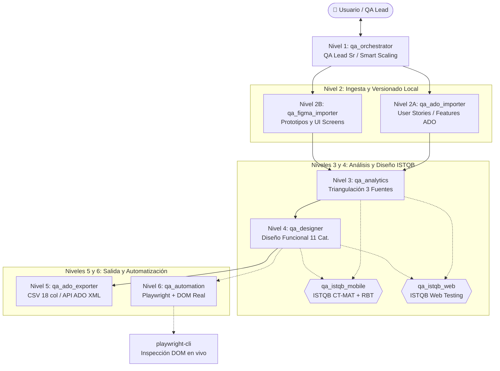

# AgenteQA — Orquestador Agéntico de Ingeniería de Calidad

Ecosistema multi-agente basado en **ISTQB**, **Azure DevOps (ADO)**, **Figma** y **Playwright** para automatizar, estandarizar y optimizar el ciclo de vida completo de QA: desde la ingesta del requerimiento y la triangulación visual, hasta el diseño funcional basado en riesgos, la exportación estructurada a Azure DevOps y la automatización y mantenimiento E2E con Playwright.

---

## 1. Arquitectura del Equipo (6 Niveles + Skills Especialistas + 11 Rules)

El orquestador opera mediante una jerarquía estructurada de **6 niveles de ejecución**, complementada por **skills transversales especializadas en estándares ISTQB** y **11 reglas mandatorias de gobernanza**.



### Tabla de Roles y Responsabilidades

| Nivel / Rol | Skill | Responsabilidad Principal |
| :---: | :--- | :--- |
| **Nivel 1** | `qa_orchestrator` | **QA Lead Sr:** Interlocutor único. Planifica, audita `input/index.json`, dimensiona instancias de agentes (*Smart Scaling*), valida Checkpoints (*Human-in-the-Loop*) y gobierna la memoria maestra. |
| **Nivel 2A** | `qa_ado_importer` | Ingesta HUs y Features desde ADO MCP, limpia HTML a Markdown legible, versiona revisiones (`System.Rev`), descarga adjuntos e indexa en `input/index.json`. |
| **Nivel 2B** | `qa_figma_importer` | Inspecciona prototipos en Figma MCP, descarga capturas PNG de pantallas y extrae textos UI y notas UX en `input/<plat>/<func>/<ID_HU>/figma/`. |
| **Nivel 3** | `qa_analytics` | Análisis estático ISTQB, triangulación de 3 fuentes (Texto HU vs. Adjuntos ADO vs. Figma), delimitación por capas (`FE`, `BFF`, `API`) y matriz de preguntas por rol (`AFU/UX`, `TL`, `PO`). |
| **Nivel 4** | `qa_designer` | Diseño funcional basado en las 11 categorías ISTQB, nomenclatura estandarizada y distribución optimizada por SO/Dispositivos (`casos_prueba_<ID>.csv` de 12 col + `_clasificados.md`). |
| **Nivel 5** | `qa_ado_exporter` | Transforma el diseño funcional a CSV de 18 columnas RFC 4180 para importación manual y, a demanda explícita, crea suites y Work Items directamente en ADO vía API con pasos en XML. |
| **Nivel 6** | `qa_automation` | **QA Automation Sr (Playwright):** Consume `playwright-cli` para automatizar o mantener tests sobre el proyecto destino, inspeccionando el DOM real sin suponer locators y respetando la arquitectura existente. |

### Skills Transversales Especialistas (ISTQB)
* **`qa_istqb_mobile`**: Especialista en **ISTQB Mobile Application Testing (CT-MAT)** y estrategia **Risk-Based Testing (RBT)** para aplicaciones bancarias (Android e iOS en Smartphone, Tablet e iPad). Guía el desglose de suites nativas, ciclo de vida de la app, conectividad, biometría y consistencia E2E.
* **`qa_istqb_web`**: Especialista en **ISTQB Web Application Testing** para banca web (Desktop en Chrome, Edge, Safari, Firefox). Guía el análisis y diseño de grillas de datos complejas, filtros, paginación, navegación por teclado/foco, sesión concurrente, refresco (F5) y exportación de archivos.
* **`playwright-cli`**: Herramienta de automatización de navegador en vivo (inspección de DOM, generación de locators resilientes y ejecución de pruebas Playwright).

---

## 2. Estrategia ISTQB Risk-Based Testing (RBT) en Mobile

Para evitar la multiplicación exponencial e ineficiente de casos de prueba (ej. clonar 19 casos idénticos por 4 dispositivos = 76 casos redundantes), el orquestador implementa la estrategia oficial **ISTQB RBT** dividiendo el diseño mobile en **3 suites especializadas**:

```text
Suite Principal de la HU (Azure DevOps)
└── FE (Frontend)
    ├── CORE        -> Lógica de negocio, reglas y validaciones funcionales (Tier 1: Android Smartphone)
    ├── iOS         -> Pruebas diferenciales exclusivas de iOS/iPadOS (Face ID, teclados, Safe Area, UIDatePicker)
    └── UI_TABLET   -> Adaptabilidad de interfaz, grillas, rotación y Safe Area en Tablets e iPads
```

1. **Suite `CORE` (Tier 1 — Android Smartphone `[AS]`):**
   - Agrupa el 100% de las reglas de negocio, validaciones de permisos, estados de datos y flujos positivos/negativos.
   - Se ejecuta sobre el dispositivo base de mayor volumen de usuarios.
2. **Suite `iOS` (Diferenciales Nativos de Apple `[iOSS]`):**
   - Cubre únicamente los riesgos nativos del ecosistema Apple: comportamiento de Face ID vs. Biometría Android, teclado numérico iOS sin botón submit, selector de ruedas `UIDatePicker`, gestos de navegación swipe-back, Safe Area con notch/Dynamic Island y permisos de App Tracking Transparency.
3. **Suite `UI_TABLET` (Adaptabilidad en Pantallas Grandes `[TA]` / `[iPad]`):**
   - Verifica presentación visual, consistencia de layout en dos columnas / master-detail, rotación vertical/horizontal (Portrait/Landscape) y áreas seguras de pantalla en iPads y tablets Android.

---

## 3. Política Anti-Duplicidad y Taxonomía de Casos

Para optimizar los tiempos de ejecución en los ciclos de entrega continua, rige una política estricta de **cero duplicidad entre casos funcionales y suites de regresión/smoke**:

1. **Una Sola Definición:** Los casos de prueba no se clonan en suites separadas. Durante el sprint activo de una nueva funcionalidad, el equipo ejecuta la **suite funcional completa**.
2. **Ejecuciones Posteriores (Smoke & Regresión):** En sprints o releases posteriores, se filtran y ejecutan únicamente los casos que ya fueron catalogados como candidatos a Smoke o Regresión.
3. **Regla de Tags en Azure DevOps:**
   - **`1 - Smoke`**: Lleva los tags de funcionalidad (ej. `qa_feature_echeq`) y `qa_type_smoke`. **NO debe incluir el tag `_regression`**, evitando que ejecuciones automáticas de regresión disparen casos de smoke innecesariamente.
   - **`2 - Regresión`**: Lleva el tag de funcionalidad y el tag específico `qa_feature_<modulo>_regression`.
   - **`3 - Funcional`**: Lleva únicamente el tag de funcionalidad `qa_feature_<modulo>`.
4. **Trazabilidad en Títulos:** Tanto los casos de **Regresión** como los de **Smoke** incluyen el identificador del Release entre corchetes (ej. `[R19]`) al inicio de su título para trazabilidad histórica.

---

## 4. Nomenclatura Estandarizada de Casos de Prueba

Los títulos de los casos de prueba se estructuran bajo una convención estricta:

```text
# Caso Funcional Estándar:
[<CAPA>] [<PLATAFORMA>] [<DISPOSITIVO_OPC>] [<AREA>] [<FUNCIONALIDAD>] - <Objetivo claro>

# Caso Candidato a Regresión:
[R<RELEASE>] [<CAPA>] [<PLATAFORMA>] [<DISPOSITIVO_OPC>] [<AREA>] [<FUNCIONALIDAD>] - Regresión: <Objetivo claro>

# Caso Candidato a Smoke:
[R<RELEASE>] [<CAPA>] [<PLATAFORMA>] [<DISPOSITIVO_OPC>] [<AREA>] [<FUNCIONALIDAD>] - Smoke: <Objetivo claro>
```

* **Capas (`<CAPA>`):** `[FE]` (Frontend), `[BE]` (BFF o API Backend).
* **Plataforma (`<PLATAFORMA>`):** `[MB]` (Mobile Banking), `[WB]` (Web Banking), `[API]` (Servicio Agnóstico).
* **Abreviatura de Dispositivo (`<DISPOSITIVO_OPC>` - opcional según suite):**
  - `[AS]`: Android Smartphone (Suite CORE).
  - `[iOSS]`: iOS Smartphone (Suite iOS).
  - `[TA]`: Tablet Android (Suite UI_TABLET).
  - `[iPad]`: iPad Tablet (Suite UI_TABLET).
* **Código de Área (`<AREA>`):** Código del equipo (por defecto `[CSM_SIF]`).
* **Funcionalidad (`<FUNCIONALIDAD>`):** Slug de la feature (ej. `[consulta_echeq]`).

---

## 5. Jerarquía y Estructura en Azure DevOps (ADO)

Al exportar casos de prueba a Azure DevOps vía API/MCP, se aplica la estructura estándar validada con el usuario bajo el protocolo **Human-in-the-Loop**:

```text
Test Plan (ej. ID 36339)
└── Suite Principal del Equipo (ej. ID 36341 - SIF - BANCOR EMPRESAS)
    └── Suite Estática: "HU <ID_HU> - <Nombre Oficial de la HU>"
        ├── Sub-suite: FE (Frontend)
        │   ├── CORE         (Test Cases de lógica y reglas de negocio)
        │   ├── iOS          (Test Cases diferenciales iOS)
        │   └── UI_TABLET    (Test Cases de layout en Tablets e iPads)
        ├── Sub-suite: BFF   (Si se diseñaron pruebas de capa Backend for Frontend)
        └── Sub-suite: API   (Si se diseñaron pruebas de contratos o servicios REST)
```

> **Regla de Oro:** La estructura de carpetas, el `planId`, el `suiteId` principal y los paths de `Area` e `Iteration` **siempre se confirman con el usuario** antes de crear elementos en ADO. Todos los Test Cases creados se vinculan automáticamente a la User Story mediante la relación `Tested By` (`Microsoft.VSTS.Common.TestedBy-Reverse`).

---

## 6. Workflows del Orquestador (`WF-01` a `WF-07`)

| Workflow | Objetivo | Agente Principal |
| :---: | :--- | :--- |
| **`WF-01`** | Ingesta, versionado (`rev`) e indexado de HU / Feature y Figma | `qa_ado_importer` / `qa_figma_importer` |
| **`WF-02`** | Análisis estático ISTQB y triangulación de 3 fuentes | `qa_analytics` |
| **`WF-03`** | Diseño de casos funcionales ISTQB (12 col) y matriz RBT | `qa_designer` |
| **`WF-04`** | Exportación a ADO (CSV 18 col RFC 4180 o API directa con XML Steps) | `qa_ado_exporter` |
| **`WF-05`** | Ciclo E2E completo (de HU en ADO a Test Cases en ADO) | `qa_orchestrator` |
| **`WF-06`** | Actualización incremental tras cambio de versión de la HU (`rev` delta) | `qa_orchestrator` (`diff_hu_versions.js`) |
| **`WF-07`** | Automatización y mantenimiento de tests E2E con Playwright | `qa_automation` (`playwright-cli`) |

---

## 7. Requisitos y Configuración Rápida

1. **Node.js `>= 20.0`** (todos los scripts `.js` del proyecto usan módulos nativos; no requieren dependencias externas).
2. **Playwright (`>= 1.59`) / `@playwright/cli`** (requerido para automatización en Nivel 6).
3. **Servidores MCP configurados (`~/.gemini/config/mcp_config.json`):**
   - `azure-devops`: `@azure-devops/mcp` autenticado con PAT en Base64 `:<PAT>`.
   - `figma_figma`: Servidor oficial MCP de Figma.
4. **Configuración del Equipo:** Ajustar valores globales en [`qa.config.json`](./qa.config.json).

---

## 8. Documentación Detallada

* 📖 **[Instructivo de Uso Completo](./docs/INSTRUCTIVO_DE_USO.md):** Guía operativa detallada, catálogo completo de prompts, referencia exhaustiva de scripts CLI y protocolos de memoria.
* 🔌 **[Guía para Otros IDEs y Agentes de IA](./docs/GUIA_OTROS_IDES_Y_AGENTES.md):** Adaptaciones para VS Code (GitHub Copilot), Claude Code, OpenAI Codex CLI y Cursor.

---

## 9. Estructura del Workspace

```text
AgenteQA/
├── .agents/
│   ├── rules/                  # 11 Reglas Mandatorias de Gobernanza y Calidad
│   └── skills/                 # 9 Skills Especialistas + playwright-cli
├── docs/                       # Instructivo operativo y guía de portabilidad multi-IDE
├── input/                      # Insumos locales versionados (index.json, INDEX.md, web/, mobile/)
├── output/                     # Entregables (analysis/, testCases/ y automation/)
├── memories/                   # Memorias vivas (~150 líneas) y archivo histórico (archive/)
├── qa.config.json              # Parámetros del equipo/tribu
└── .gitignore
```
